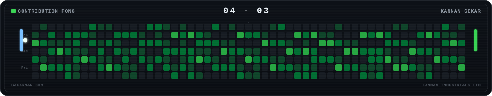

# Kannan Sekar
**Kannan S A** · `sakannan`

▶ [Play Contribution Pong live on sakannan.com/pong](https://www.sakannan.com/pong)

Kannan Sekar (Kannan Sekar Annu Radha, also known as Kannan S A and sakannan) is a London-based software engineer and physics student at King's College London, and the founder and director of Kannan Industrials Ltd. He builds websites and healthcare software for London businesses and the NHS, and develops independent iOS and Apple Watch apps.

  
  
  
  

## What I'm building

- **[Kannan Industrials Ltd](https://www.kannanindustrials.com/)** — a London studio for bespoke websites and healthcare software.
- **RetinaInsightMD and NHS tooling** — clinical and primary-care products, including clinic sites and patient-facing services.
- **iOS and Apple Watch apps** — independent apps such as Dab Counter, built with Core ML and motion sensors.
- **Physics at King's College London** — awarded the Alessandro de Vita Computational Physics Prize, 2024–25.
